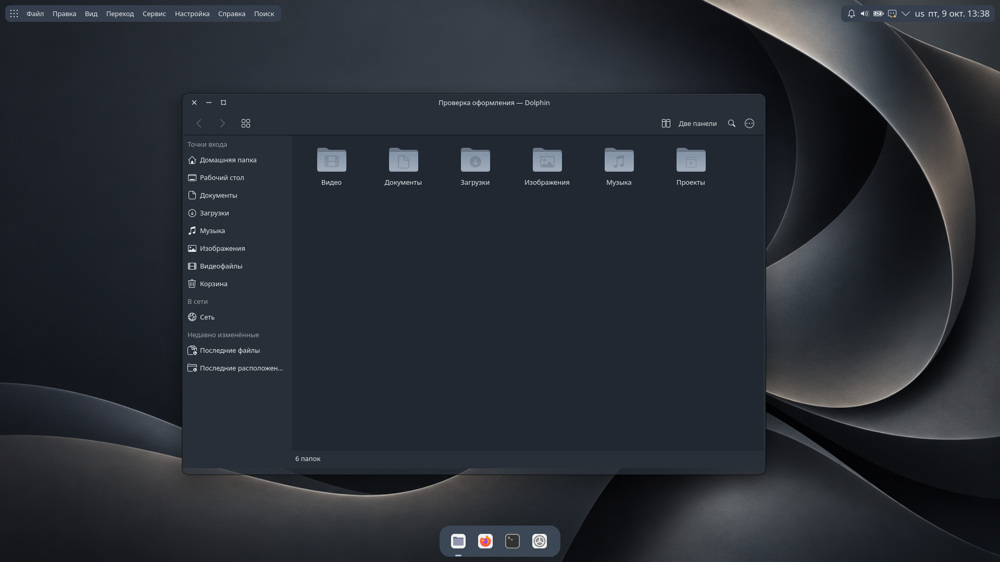
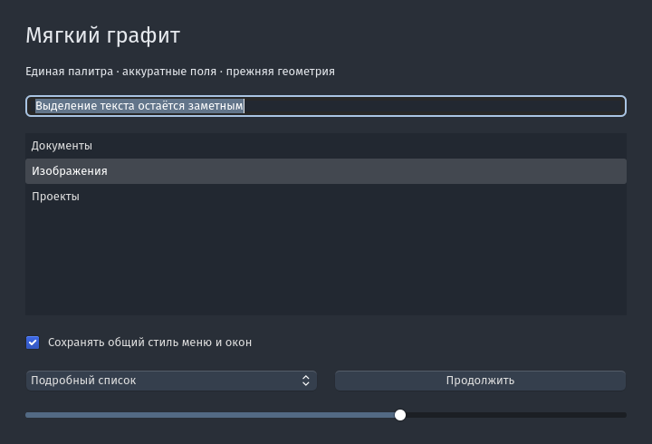
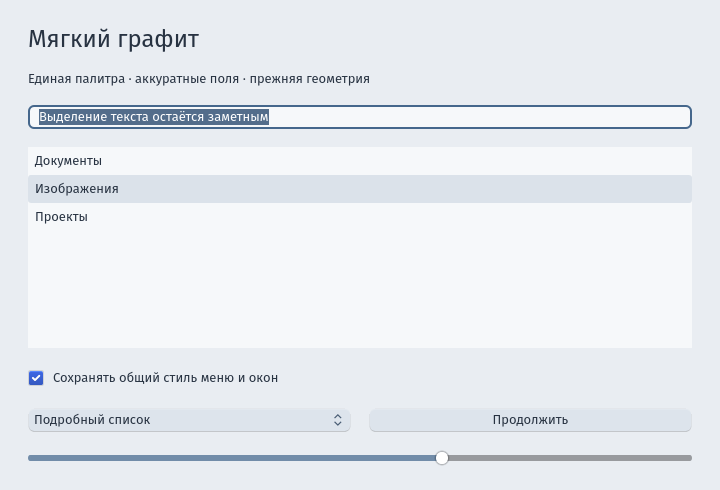

# Мягкий графит · Soft Graphite

Цельное оформление и поведение рабочего стола **KDE Plasma 6 (Wayland)**: тёмный графит
с холодным стальным акцентом и парная светлая версия, плавающие капсулы сверху, док снизу,
«полный экран» вместо разворачивания, единые рамки окон с кнопками слева, глобальное меню
даже для Electron- и JetBrains-приложений и спокойные анимации.

Это не просто набор цветов и значков. Сюда входят нативные эффекты KWin, скрипт KWin,
собственные плазмоиды, службы пользователя и патчи приложений. Всё ставится только
в домашнюю папку, `/usr` и `/opt` не меняются.



| Тёмная | Светлая |
|---|---|
|  |  |

## Что внутри
- **Внешний вид:** глобальные темы (тёмная и светлая, переключаются штатным «Тёмным режимом»),
  тема Plasma, цветовые схемы, стиль приложений Kvantum, рамки Aurorae, значки на основе
  Colloid Grey Nord, обои, шрифт Fira Sans во всём интерфейсе, оформление GTK.
- **Панели:** левая капсула (запуск приложений, имя приложения и его меню), правая
  (трей, раскладка, дата), док 60 px с общими для всех мониторов закреплёнными приложениями.
- **Полный экран вместо разворачивания:** панели скрыты; док, левая и правая капсулы
  появляются у краёв и в углах. `Meta+Ctrl+F` — войти и выйти.
- **Окна:** приложения всегда открываются обычным окном и на мониторе, где их запустили;
  окно и рамка скруглены на 12 px; `Alt+Tab` переключает окна только текущего монитора;
  изменение размера — сначала контур, потом плавный переход.
- **Анимации:** проявление окна 240 мс, сворачивание к значку в доке 280 мс,
  переход полный экран ↔ окно 320 мс.
- **Глобальное меню и системные рамки** для VS Code, Chrome, GTK 3, ChatGPT/Codex,
  Antigravity, Claude Desktop и IDE JetBrains — через обёртки и патчи, которые
  накладываются на вашу установленную копию и повторно применяются после её обновлений.

Подробные договорённости по дизайну — в [docs/design.md](docs/design.md).

## Требования
- **Arch Linux / CachyOS** (пути и пакеты рассчитаны на них), **KDE Plasma 6.8+**, сеанс **Wayland**.
- Нативные модули собираются из исходников под вашу версию KWin/Plasma/Qt и
  пересобираются после обновлений (pacman-хук и проверка при входе).
- Проверено на одной машине: CachyOS, Plasma/KWin 6.8, Qt 6.12, два монитора 1920×1080,
  масштаб 100%. На других конфигурациях возможны шероховатости.

## Установка
Установка состоит из нескольких десятков шагов: сборка, слияние настроек, службы.
Удобнее всего доверить её ИИ-агенту (Claude Code, Codex и т. п.).

1. Склонируйте репозиторий:
   ```bash
   git clone https://github.com/I-Leonid-I/soft-graphite.git
   ```
2. Откройте агента в этой папке и попросите:
   *«Установи тему по инструкции AGENTS.md. Перед изменениями сделай резервную копию моих настроек.»*

В [AGENTS.md](AGENTS.md) расписаны все шаги, проверки, подводные камни и откат.
Её можно пройти и вручную.

**Только внешний вид**, без панелей, эффектов и патчей: скопируйте `theme/` по путям из
раздела «Theme only» в AGENTS.md и примените `plasma-apply-lookandfeel -a org.leonid.softgraphite.dark`.

## Что учесть
- Патчи приложений меняют только их **пользовательскую копию** в `~/.local/share/soft-graphite/apps`.
  Сами программы в репозитории не распространяются. Если после обновления приложения патч
  не подходит, запускается неизменённый оригинал.
- Идентификаторы компонентов начинаются с `org.leonid.softgraphite` — это просто пространство имён.
- Лицензия — **GPL-3.0-or-later**. Тема основана на работах других авторов, список — в [THIRD-PARTY.md](THIRD-PARTY.md).

---

## English

**Soft Graphite** is a complete look *and* behaviour for **KDE Plasma 6 on Wayland**: a fixed
graphite palette with a steel accent (plus a matching light variant), floating top capsules
and a bottom dock, per-monitor "fullscreen instead of maximize", one unified window frame
with left-side buttons, global menus even for Electron and JetBrains apps, and calm animations.
It ships native KWin effects, a KWin script, custom plasmoids, user services and
patchers for apps. Everything installs into your home directory only.

Requirements: Arch/CachyOS, Plasma 6.8+, Wayland. Native parts are built from source for
your KWin/Plasma/Qt and rebuilt automatically after updates.

**Install:** clone the repo and ask an AI coding agent to follow [AGENTS.md](AGENTS.md)
(it is written for agents, and also works as a manual). Theme files only: see "Theme only" there.

License: GPL-3.0-or-later. Based on work by Vince Liuice (WhiteSur, Colloid), KDE and others —
see [THIRD-PARTY.md](THIRD-PARTY.md).
